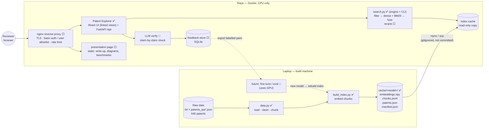
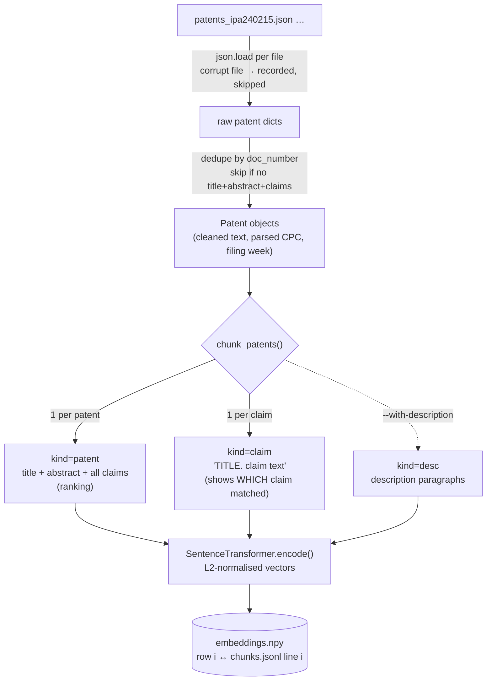
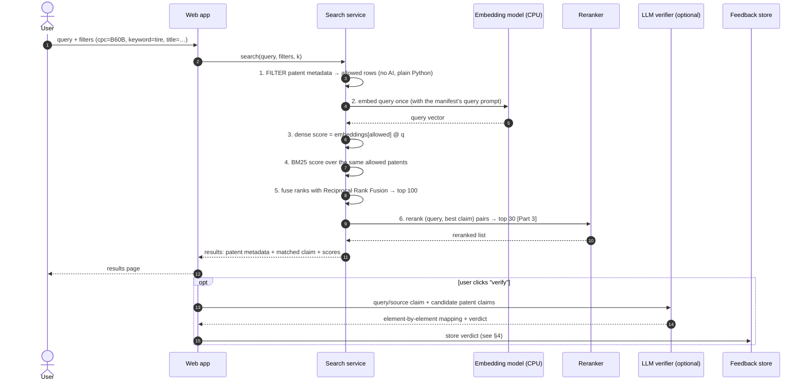
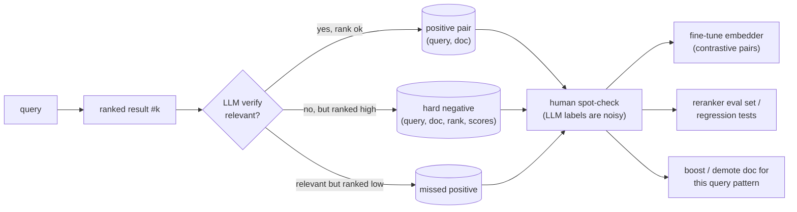
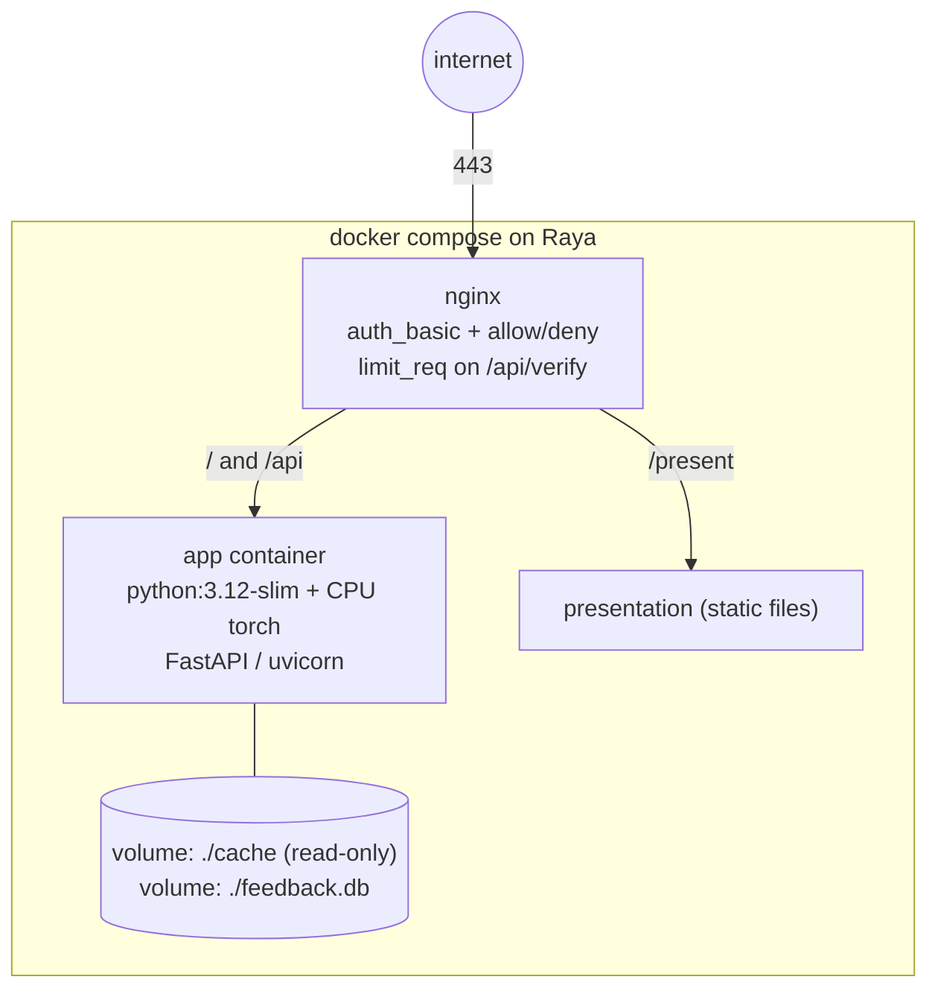

# Architecture

Living map of the system. Status: ✅ built · 🟡 next · ⬜ planned · 💭 idea / open question.

**Principle:** do the heavy computation (parsing, embedding) on the **laptop**, produce a
self-contained **index cache**, then ship that cache to **Raya** (Docker, CPU only), which
only has to embed a single query at a time and do cheap math.

---

## 1. System overview

---

## 2. Offline pipeline (laptop) — ✅ built

**Why two kinds of chunk:**
- A combined title + abstract + claims vector ranks *patents* best. In the 2026 patent-embedding benchmark ([arXiv 2605.24297](https://arxiv.org/html/2605.24297)) this view won for 13 of 19 models, and claim 1 alone was consistently the weakest.
- Per-claim vectors don't rank patents as well. What they give you is the *explanation*: which claim lines up with the query.
- About two-thirds of claims are dependent ("The spoke of claim 1, wherein…"). Prefixing each claim chunk with the patent title gives it topic context, and `parent_claim` records the dependency.

---

## 3. Query pipeline — ✅ built as `search.py` (steps 1–5 and the explain step); rerank and verify ⬜

**Points that matter for the hybrid-search timing question:**
- **Filtering happens before scoring (pre-filtering).** A filter that keeps 10% of patents cuts the dense step to 10% of the rows, so hybrid search ends up *faster* than plain search. `bench.py` will measure it.
- **An exact title search never calls the model.** It's a dictionary lookup.
- **We stay with brute-force numpy search.** 11K × 1024 floats is about 46 MB, and one matrix multiply over that takes milliseconds. An approximate index (FAISS/HNSW) only pays off at around 1M+ vectors; see `DESIGN.md` for the 10M-patent version.

---

## 4. Verify-and-feedback loop — 💭 idea

When the LLM verifier reads a top-ranked result and decides it doesn't actually match, that's a
**hard negative**: text the search thought was close but isn't. Hard negatives are the most
valuable kind of training data.

**Feedback record** (one SQLite row per verdict):

| field | example |
|---|---|
| `ts`, `query`, `filters` | `2026-11-06T…`, `"tire bead reinforcement"`, `{"cpc":"B60C"}` |
| `doc_number`, `rank`, `dense_score`, `bm25_score`, `rerank_score` | `20240051339`, `3`, `0.71`, `12.4`, `0.88` |
| `verdict`, `confidence`, `rationale` | `not_relevant`, `0.8`, `"claims a tread pattern, not the bead"` |
| `embed_model`, `reranker`, `verifier` | versions copied from manifest/config, so old labels can be traced |
| `reviewed` | `null` / `accepted` / `rejected` (filled in by a person) |

**Open questions**
- **Where the verifier LLM runs.** Raya has no GPU, so a local LLM there would be very slow. The options are:
  - (a) the Claude API: a key on the server, rate-limited behind nginx, never exposed to the browser;
  - (b) a GPU worker on the laptop that Raya calls when it's online;
  - (c) off by default in the demo.
- **What gets verified:** only results the user clicks (cheap), or the top-N of every query (expensive).

---

## 5. Deployment on Raya — 🟡 written ([deploy/README.md](deploy/README.md)); not yet run on Raya

- **The image ships the code and CPU-only PyTorch.** The index cache is mounted as a volume rather than baked into the image, so a rebuild on the laptop just means syncing a folder.
- **The container downloads the embedding model on its first start** (or it's baked into the image). It must be the **same model id and query prompt** as `manifest.json`; the app should refuse to start on a mismatch.
- **Rough memory:** Qwen3-Embedding-0.6B in fp32 needs about 2.4 GB of RAM, plus about 50 MB of index.

**Raya's budget.** Raya is a free Hostinger staging box in Boston: 16 GB RAM, 4 vCPU, 200 GB NVMe. It must stay lightly used.

| item | budget / choice |
|---|---|
| Upload from laptop | **under 30 MB**, once per index rebuild. Ship a slim export: no description text, float16 vectors, gzipped. |
| Model weights | downloaded by Raya directly from Hugging Face, once: MiniLM about 90 MB, Qwen3-0.6B about 1.2 GB |
| RAM at rest | MiniLM about 0.5 GB; Qwen3 about 3 GB (out of 16) |
| Query embedding | CPU only: MiniLM about 10 ms; Qwen3 roughly 0.1–0.5 s (to be measured) |
| Reranker | `ms-marco-MiniLM-L-6` on the top 30–50 (about 1 s on CPU). `bge-reranker-v2-m3` is too heavy for 4 vCPU. |
| LLM verify | not on Raya: Claude API (rate-limited) or turned off |
| Traffic | behind nginx auth, so only whitelisted reviewers, and nothing runs in the background |

---

## 6. Modules and data contracts

| Module | Status | Role |
|---|---|---|
| `data.py` | ✅ | load / clean / chunk; `parse_cpc`, `tokenize` (for BM25) |
| `build_index.py` | ✅ | `MODELS` registry, `build()`, `load_index()`; writes `cache/<model>/` |
| `search.py` | ✅ | `SearchEngine` + CLI. Filters: CPC prefix (sorted index plus binary search), keywords (inverted index), exact title (dict), week range. Dense + BM25 merged with Reciprocal Rank Fusion. Matched claim per result. `--like` / `--like-claim` use a patent or a claim as the query. |
| `bench.py` | ✅ | pre- vs post-filter timings per stage, plus a synthetic scale test; writes `results/bench_<model>.md` |
| `rerank.py` | ✅ | Part 3: `Reranker` (cross-encoder) + `two_phase()`: stage 1 picks 100 candidates, the reranker keeps 30. The reranker reads `TITLE. abstract  Claim N: <best claim>`. Also available as `search.py --rerank minilm\|bge`. |
| `eval_rerank.py` | ✅ | silver-label evaluation: query = a patent's first claim, relevant = the same CPC main group. Reports P@10, nDCG@10, MRR@30, R@30 for BM25, dense, hybrid, and hybrid + each reranker. |
| `export_index.py` | ✅ | slim bundle for the server: 512-d float16, no canceled claims, no chunk text or descriptions. 70 MB becomes **16 MB, or a 10.7 MB tar.gz**. |
| `app/` | ✅ | FastAPI: `/api/explore` (linked-views payload: results + CPC + week facets for one set, request id echoed), `/api/meta`, `/api/search`, `/api/patent/{doc}`, `/api/health`, `/api/docs`. It serves the built Patent Explorer at `/` and the original page at `/simple`. Stale responses are dropped (request sequence + AbortController). "More like this" never calls the model. Tested locally: about 98 ms per query, 10 ms for "more like this". |
| `web/` | ✅ | **Patent Explorer** (Part 3b): React 19 + TypeScript + Vite, built into `app/static/`. It has three linked views (results with why-it-matched, CPC drill-down, weekly timeline with drag-select), filter chips, saved views, URL state, and a live latency readout. `useExplore.ts` holds the stale-result guard; views render from the state that produced their data. |
| `test_explore.py` | ✅ | invariants: facet counts sum to the total; clicking a facet yields its count; results satisfy every filter; filtering never reorders; filter order doesn't matter |
| `presentation/` | ⬜ | static write-up page |
| `deploy/` | 🟡 | Part 2 proof of concept: `Dockerfile` (CPU-only torch), `docker-compose.yml` (app + nginx, resource limits, model-cache volume), `nginx.conf` (basic auth, optional allowlist, 2 req/s per IP, noindex), and a step-by-step runbook in `deploy/README.md`. **Written, but not yet built:** there's no Docker on the laptop. |
| `verify.py` + feedback | 💭 | LLM check + SQLite feedback (§4) |
| `DESIGN.md` | ✅ | Part 2: the system at 10M patents (Postgres + pgvector, GPU batch embedding, sizing, cost, monitoring, challenges, build order) |
| `smoke_test.py` | ✅ | end-to-end check of a running API, over HTTP only: known items, self-retrieval, filter correctness, "more like this", latency. Exits non-zero on failure. Works against Raya: `--url … --user reviewer`. |
| `eval_hybrid_weight.py` | ✅ | sweeps the BM25 fusion weight on the known items and the claim queries |
| `eval_compression.py` | ✅ | quality vs vector size and precision (Matryoshka truncation, int8, binary); evidence for DESIGN.md §4 |

**The cache contract** (`cache/<model>/`, written by `build_index.py`):

| file | contents |
|---|---|
| `embeddings.npy` | float32 `[n_chunks, dim]`, L2-normalised. Row `i` belongs to `chunks.jsonl` line `i`. |
| `chunks.jsonl` | `chunk_id, doc_number, kind (patent / claim / desc), text, claim_no, parent_claim, para_no` |
| `patents.json` | `doc_number, title, abstract, claims[], description[], classification, cpc{section, class, subclass, group, display}, week, source_file, missing[]` |
| `manifest.json` | `model_id`, `query_prompt`, `dim`, `max_seq_length`, counts, `load_report`, `timings_s`, machine info |

---

## 7. Facts measured so far

- **Small set:** 64 files, 640 patents, no duplicate `doc_number`s, no unreadable files.
- **Chunks:** 11,218 in total, i.e. 640 patent chunks plus 10,578 claim chunks.
- **Missing data:** 119 patents (19%) have an **empty description** (`[""]`). They're kept, since descriptions aren't embedded by default.
- **Dependent claims:** about 67% of claims reference another claim.
- **Canceled claims:** 167 claims across 25 patents are withdrawn placeholders (`(canceled)`, `1 - 15. (canceled)`). They're kept in `claims[]` so claim numbering stays intact, but they're never embedded or shown as a match (`data.is_canceled`). Older caches are filtered at search time.
- **Claim 1 is truncated in the data:** its preamble is stripped (e.g. it starts "an axle body, …").
- **Classification codes** look like `B60B104FI`, which we parse as `B60B 1/04` plus the suffix `FI`. That's inferred from the format, so filters use the raw prefix.
- **Index build timings (11,218 chunks):**

  | model | device | time | rate | vectors | cache folder |
  |---|---|---|---|---|---|
  | MiniLM-L6 (384-d) | CPU | 84 s | 133 chunks/s | 17 MB | 40 MB |
  | Qwen3-Embedding-0.6B (1024-d) | CPU | about 2 h (measured on 20 patents) | about 1.5 chunks/s | — | — |
  | Qwen3-Embedding-0.6B (1024-d) | **RTX 5080 laptop** | **185 s** | 61 chunks/s | 46 MB | 68 MB |

  The long patent chunks (up to 2,048 tokens) dominate the cost, which is why the GPU is about 40× faster here.
- **Query-time cost** (CPU only, 4 threads, as on Raya):

  | model | embed one query | score all 11K rows |
  |---|---|---|
  | MiniLM | 10 ms | 0.7 ms |
  | Qwen3 (bf16, the default) | 162 ms | 1.0 ms |
  | Qwen3 (`EMBED_DTYPE=float32`) | 319 ms | 1.0 ms |

  bf16 is only fast on CPUs with native bf16 support, so re-measure on Raya.
- **Patent Explorer UI** ([results/ui_latency.md](results/ui_latency.md)):
  - **Update time:** filter change → DOM commit takes 36 ms p50 / 56 ms p95 through the server (server 5 ms), and 7 ms p50 from the client cache.
  - **Stale results:** with a simulated slow, out-of-order server, 0 of 166 mid-flight samples had the views disagreeing, after fixing a bug where the CPC view mixed the new selection with old counts.
  - **CPC parser bug the UI exposed:** 5-digit codes are 2 + 3 digits (`B60C15024` → `B60C 15/024`), not `150/24`. `SearchEngine` re-parses codes at load, so older caches pick up the fix.
- **Hybrid-search benchmark** (full tables: [results/bench_qwen3.md](results/bench_qwen3.md), [results/bench_minilm.md](results/bench_minilm.md)):
  - **The query embedding dominates.** Qwen3 takes about 130 ms per query on CPU, while all the search work (filter, dense, BM25, fuse, explain) takes **1–3 ms**. At 640 patents, filtering can only save about 2 ms. The real cost is the model.
  - **Selective filters help.** `cpc=B60C 23/` (28 patents) runs in 0.86 ms with pre-filtering vs 3.16 ms with post-filtering, and `kw=sensor` in 1.1 ms vs 2.4 ms. Broad filters (about 50% pass) barely change anything.
  - **The filters themselves cost almost nothing:**
    - CPC prefix: about 0.04 ms (it was 5 ms with a string scan before the sorted prefix index)
    - keywords: about 0.05 ms through the inverted index
    - exact title with no query: **0.03 ms**, with no model call
  - **The synthetic scale test shows the layout matters most.** At 256K patents:

    | filter | post (score all) | pre (gather rows) | pre + partitioned (slice) |
    |---|---|---|---|
    | 10% pass | 16 ms | **30 ms** | 2.1 ms |
    | 1% pass | 16 ms | 3.3 ms | 0.65 ms |

    Copying the passing rows out of a big matrix can cost *more* than scoring everything.
- **End-to-end smoke test** (`smoke_test.py` against the running API; [results/smoke_127_0_0_1.md](results/smoke_127_0_0_1.md)): **PASS**.
  - **Known items:** 12 patents described in my own words, avoiding title words. Dense finds 10/12 at #1 and 12/12 in the top 3. Hybrid (w = 0.1) finds 8/12 at #1, 11/12 in the top 3, and 12/12 in the top 10.
  - **Self-retrieval over all 640 patents:**
    - **By abstract:** 617/640 at #1 and 640/640 in the top 10. The misses are sibling applications with near-identical text (e.g. three "BICYCLE HUB SYSTEM…" filings).
    - **By first claim:** 618/640 at #1. The 3 that fall outside the top 10 have claim 1 cut down to a bare list of parts, because the data strips the preamble ("a stem member…; a wheel…").
  - **Filters:** 0 violations across 5 checks.
  - **"More like this":** never returns the source patent, and 63% of neighbours share its CPC main group.
  - **Latency:** p50 25 ms, p95 740 ms on laptop CPU. Long abstract-length queries are the slow ones.
- **BM25 weight in hybrid fusion** ([results/hybrid_weight_sweep.md](results/hybrid_weight_sweep.md)):
  - **The problem:** equal weights let BM25 drag dense #1 hits down to #15–#23 on paraphrased queries.
  - **The sweep:** hand-written descriptions do best at w = 0, with MRR 0.92 (0.56 at w = 1). Claim queries do best at w = 0.1–0.25, with nDCG@10 0.548 (0.539 at w = 0 and 0.520 at w = 1).
  - **The default is now w = 0.1** (`search.BM25_WEIGHT`). The reranking tables below used the original w = 1.0 hybrid as stage 1.
- **Reranking evaluation:** 100 claim queries, silver labels (relevant = same CPC main group), random-baseline P@10 = 0.066. Full results: [results/rerank_eval_qwen3_minilm_k100_len512_n100_w1.md](results/rerank_eval_qwen3_minilm_k100_len512_n100_w1.md).

  | system | P@10 | nDCG@10 | MRR@30 | R@30 | rerank time per query (CPU) |
  |---|---|---|---|---|---|
  | BM25 | 0.376 | 0.418 | 0.668 | 0.247 | – |
  | dense (Qwen3) | **0.509** | **0.540** | 0.715 | **0.322** | – |
  | hybrid (dense + BM25, RRF) | 0.489 | 0.528 | **0.744** | 0.314 | – |
  | hybrid + MiniLM (100 candidates, 512 tokens) | 0.433 | 0.460 | 0.655 | 0.278 | 4.5 s (12 threads) |
  | hybrid + MiniLM (50 candidates, 256 tokens; Raya setup) | 0.456 | 0.487 | 0.679 | 0.302 | 3.2 s (4 threads) |
  | **fix 1:** hybrid + MiniLM, ranks merged with stage 1 (RRF) | 0.490 | 0.513 | 0.674 | 0.311 | 3.2 s |
  | **fix 1 + 2:** RRF + query capped at 128 tokens | 0.486 | 0.514 | 0.692 | 0.312 | 2.9 s |
  | **fix 1 + 2:** RRF + query capped at 64 tokens (**new default**) | 0.487 | 0.517 | 0.698 | 0.316 | 2.6 s |

  Fixed variants: [results/rerank_eval_qwen3_minilm_k100_len512_n100_fix_w1.md](results/rerank_eval_qwen3_minilm_k100_len512_n100_fix_w1.md)

  - **The off-the-shelf MiniLM reranker hurts.** It's worse on 59 of 100 queries and better on only 30.
  - **Likely causes:**
    - It was trained on web Q&A (MS MARCO), not patent claims.
    - Claim queries are long and eat most of the 512-token input, so the candidate gets truncated.
    - Its scores *replace* stage-1 scores instead of being combined with them.
  - **bge-reranker-v2-m3 isn't viable on CPU:** 67 s per query at 12 threads, 631 s at 4 threads. It needs the GPU.
  - **What the fixes did:**
    - **Merging ranks (RRF) recovers most of the loss:** nDCG@10 goes from 0.460 to 0.513, and per-query results go from 30 better / 59 worse to 44 / 44.
    - **Capping the query** adds a little accuracy (up to 0.517, 47 better / 40 worse) and cuts rerank time by about 20%, because the input is shorter.
    - **The reranker still doesn't beat stage 1** on these labels (hybrid 0.528, dense 0.540). A 47-vs-40 split is well within noise (sign test p ≈ 0.5).
    - **On plain-English queries the fixed reranker looks sensible.** It promotes pressure-monitoring patents, and the #58 → #1 jump on the spoke query is gone.
  - **Decisions:**
    - `rerank.py` now defaults to `fuse="rrf"`, `query_max_tokens=64`.
    - **Reranking is opt-in** in the app: it costs about 2.6 s per query on CPU with no measured gain.
    - **Re-run on the current stage 1** (w = 0.1, nDCG@10 0.548; [results/rerank_eval_qwen3_minilm_k100_len512_n100_w0.1.md](results/rerank_eval_qwen3_minilm_k100_len512_n100_w0.1.md)): RRF gives 0.531 and RRF + query cap gives 0.525. Reranking still loses on nDCG@10 but slightly raises R@30 (0.337 vs 0.323). The query cap's earlier gain didn't reproduce; it's kept for speed only.
  - **Still open:**
    - bge-reranker-v2-m3 on the GPU
    - fine-tuning the reranker on silver or feedback pairs (§4), i.e. adapting it to the domain instead of using a web-search model as is
    - better labels: citations, or examiner-style judgments on a small hand-labelled set Storing vectors **grouped by CPC subclass** turns a filter into a contiguous slice, which is 8–25× faster than post-filtering. At 10M patents this becomes "partition / shard the index by classification" (see `DESIGN.md`).
- **Sanity query** "tire with a sensor that monitors air pressure":
  - **Qwen3's** top 3 are tread-wear sensing (B60C 11/24), tire management (B60C 23/04) and leak detection (B60C 23/00), so 2 of 3 are pressure-related.
  - **MiniLM's** top 3 are 2× tread-wear monitoring and a sensor-container assembly.
