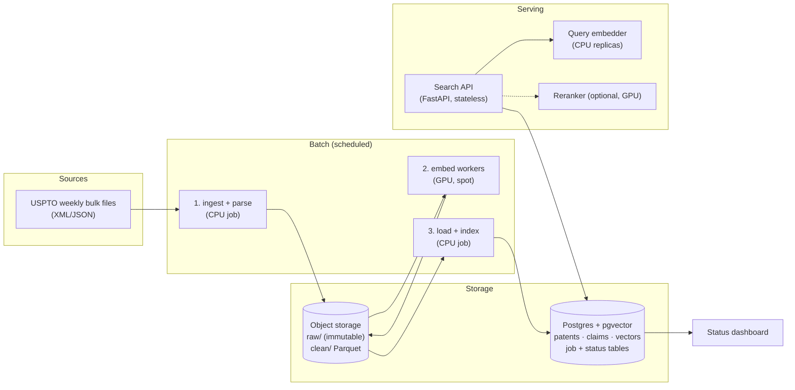
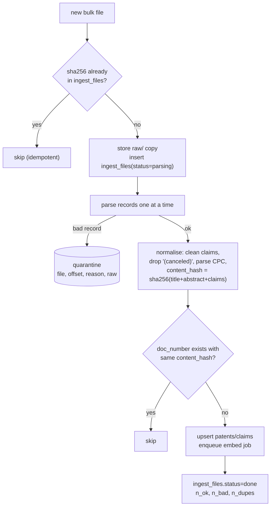

# Design: the patent search engine at 10M patents

**Audience:** an intern who has read the README and run `search.py` on the small set.
**Goal:** serve the same hybrid search (filters + dense + keyword, plus the matched claim) over about **10M patents**, with weekly updates.
**Approach:** keep it simple. One Postgres database, one GPU batch job, one stateless API. Every number below is either **measured** in this repo (marked 📏) or a **rough estimate** (marked ≈). Cloud prices change, so check them before quoting.

---

## 1. What changes from the prototype

| | prototype (`search.py`) | at 10M patents |
|---|---|---|
| data | 640 patents, in RAM | ≈ 680 GB of raw JSON (📏 about 68 KB per patent in the large sample) |
| vectors | numpy matrix, brute force | Postgres + pgvector **HNSW** index (approximate nearest neighbours) |
| vector size | 1024-d float32 = 4 KB | **512-d, half or 8-bit precision**: 0.5–1 KB (📏 no measurable quality loss, see §4) |
| filters | numpy masks, inverted index | SQL `WHERE` + table **partitions by CPC section** |
| keyword | `rank_bm25` in memory | Postgres full-text (GIN index), with BM25 via `pg_search` later |
| claim vectors | all in RAM | stored per patent, **never ANN-indexed**: only fetched for the top-k results |
| updates | rebuild everything | weekly incremental job; re-embed only new or changed patents |
| embedding | one laptop GPU | GPU batch workers pulling from a job queue |

**The key structural decision:**
- Rank on **one vector per patent**: title + abstract + claims, the best view in the [patent-embedding benchmark](https://arxiv.org/html/2605.24297).
- Use **claim vectors only to explain** the top results.
- This keeps the ANN index at 10M vectors instead of about 200M (📏 about 20 claims per patent).

---

## 2. Components

| component | what it is | why this choice |
|---|---|---|
| Object storage (S3 / GCS / MinIO) | `raw/` source files as downloaded (never edited) and `clean/` Parquet shards (patents, claims, vectors) | cheap, versioned, and everything can be rebuilt from it |
| Postgres 16 + pgvector ≥ 0.8 | metadata, text for display, full-text index, vectors + HNSW, job/status tables | **one system** to run, back up and query. SQL does the filters. |
| Ingest job | Python: download → validate → normalise (`data.py` logic) → Parquet | the existing code, run per file |
| Embed workers | Python + sentence-transformers on GPU; they pull batches from a `jobs` table | horizontally scalable; works on spot instances because jobs are retryable |
| Load/index job | `COPY` the Parquet vectors into Postgres, then build or refresh the HNSW index | bulk loading is 10–100× faster than row inserts (≈) |
| Search API | today's `SearchEngine` logic with SQL instead of numpy | stateless, so you can run N copies |
| Query embedder | the same model + query prompt as the index (from the manifest) | 📏 162 ms per query on 4 CPU threads |
| Dashboard | SQL views over the status tables (Grafana or Metabase) | §6 |

---

## 3. Pipelines

### 3.1 Ingest (weekly, plus one-off backfill)

- **One bad record never fails a file. One bad file never fails a run.** Bad items go to `quarantine` with a reason. The large sample already has corrupted entries and duplicates (per its README).
- **Missing fields:** keep the patent if it has a title, an abstract or claims, and record what's missing, the same rule as `data.py`. 📏 In a 2,000-patent sample of the large set, **37% have no classification** (`N/A`) and 1.3% have no description.
- **Dedupe key:** `doc_number`. **Change detection:** `content_hash`. A republished application with identical text is a no-op.

### 3.2 Embed (GPU batch)

- **The work unit is 1,000 patents** (the large dataset is already batched this way). Each job row looks like `(job_id, model_version, batch_id, status, attempts, worker, heartbeat_at, error)`.
- **Workers claim jobs** with `SELECT … FOR UPDATE SKIP LOCKED`, so many workers can share the table without a separate queue service.
  - A worker writes `clean/vectors/model=<v>/batch=<id>.parquet`, then marks the job `done`.
  - A job whose heartbeat is older than 10 minutes goes back to `pending`, so a lost spot instance costs at most one batch.
- **The output is idempotent**: keyed by `(doc_number, model_version, content_hash)`. Re-running a batch overwrites the same file.
- **Retries:** a GPU out-of-memory error means splitting the batch in half and retrying. After 3 failures the job goes to `failed` with the error, for a human to look at.
- **Vectors written:**
  - one patent vector (title + abstract + claims, truncated to 2,048 tokens, **first 512 dimensions**)
  - one vector per non-canceled claim (**first 256 dimensions**, explain only)

### 3.3 Load and index

- **Bulk-load** with `COPY` into a staging table, then swap it in.
- **Build HNSW per partition** with `m=16, ef_construction=64` (pgvector defaults; tune later).
- **New embedding model = blue/green:**
  - Write the new vectors under the new `model_version` and build its index next to the old one.
  - Run the evaluation (§7) against both.
  - Flip the `active_model` setting only if the new one is at least as good.
  - Keep the old version for one week so you can roll back.

### 3.4 Query (online)

1. **Parse filters.** A CPC filter becomes partition pruning plus a btree on `cpc_subclass`. Keywords become `tsvector @@ tsquery` on title/abstract (GIN). Exact title uses a btree on `lower(title)`.
2. **Estimate how many patents pass the filters** (a cheap count using the indexes).
   - **Under about 50K** → **exact scan** of just those rows (no ANN). It's accurate, and 📏 scoring 25.6K vectors took about 2–3 ms in numpy (Postgres will be slower, ≈ tens of ms).
   - **Otherwise** → **HNSW with iterative scan** (`hnsw.iterative_scan = relaxed_order`). This stops very selective filters from returning fewer than k results.
3. **Embed the query**, then run dense top-100 and keyword top-100 and merge them with Reciprocal Rank Fusion (same as now).
4. **Fetch claim vectors** for the top 30 only and pick the best-matching claim (the "why it matched").
5. **Optional rerank** (opt-in): 📏 a web-trained cross-encoder did **not** improve results here (see ARCHITECTURE.md §7), so it stays off until a domain-tuned one exists.

📏 **Why partition by CPC:** in `bench.py`'s scale test, scoring a contiguous slice was 8–25× faster than scoring everything and filtering afterwards. Gathering scattered rows was sometimes *slower* than scoring everything. Partitioning gives contiguous storage per technology area.

---

## 4. Sizing

📏 **Measured quality vs vector size** (100 claim queries, dense ranking only; [results/compression_qwen3.md](results/compression_qwen3.md)):

| vector format | bytes | 10M patents | nDCG@10 |
|---|---|---|---|
| 1024-d float32 (prototype) | 4,096 | 41 GB | 0.540 |
| 1024-d int8 | 1,028 | 10 GB | 0.540 |
| **512-d int8 / fp16** | 516 / 1,024 | **5–10 GB** | **0.538** |
| 256-d int8 | 260 | 2.6 GB | 0.514 |
| 1024-d binary | 128 | 1.3 GB | 0.514 (fine as a first pass with a rescore) |

So: **512 dimensions**, stored as `halfvec(512)` in pgvector (fp16; pgvector has no int8 type) = about 10 GB, or int8 in a dedicated vector database.

| item | per patent | 10M patents |
|---|---|---|
| raw JSON in object storage | 📏 about 68 KB | ≈ 680 GB |
| clean Parquet (text + metadata, zstd) | ≈ 15 KB | ≈ 150 GB |
| Postgres text (title, abstract, claims, metadata) + GIN index | ≈ 9 KB | ≈ 90 GB |
| patent vectors `halfvec(512)` | 1 KB | 10 GB |
| HNSW graph (m=16) | ≈ 0.2–0.3 KB | ≈ 2–3 GB |
| claim vectors, 256-d fp16, about 19 per patent | ≈ 10 KB | ≈ 100 GB (on disk; read about 600 per query) |
| **Postgres total** | | **≈ 200–250 GB disk; 32–64 GB RAM** so the HNSW index and hot pages stay in memory |

**Embedding compute** (one-off backfill):
- 📏 The RTX 5080 laptop embedded **640 patents (11,218 chunks) in 185 s**, i.e. 3.5 patents/s, unoptimised.
- At that rate 10M patents ≈ **800 GPU-hours**.
- With length-sorted batches, a 512-token cap on the patent text, and fp16 with flash attention, expect ≈ 3–5× faster, so ≈ **160–270 GPU-hours**.

**Weekly updates:** ≈ 7K new US publications per week ≈ 35 minutes of one GPU.

---

## 5. Cost (≈, monthly unless noted)

| item | assumption | ≈ cost |
|---|---|---|
| Backfill embedding (**one-off**) | 160–270 L4-class GPU-hours; spot at about $0.3/h, on-demand at about $0.7/h | **$50–200** |
| Weekly embedding | under 1 GPU-hour per week, spot | under $5 |
| Postgres VM | 8 vCPU, 64 GB RAM, 500 GB SSD, self-managed (managed ≈ 2×) | $300–500 |
| API + query embedders | 2 × (4 vCPU, 16 GB); each ≈ 3–6 queries/s with Qwen3 on CPU (📏 162 ms/query) | $100–250 |
| Object storage | about 850 GB (raw + clean) | about $20 |
| Monitoring / logs | hosted free tier or a small VM | $0–50 |
| **Total, self-managed** | | **≈ $450–850 / month** (+ $50–200 one-off) |
| Optional: GPU reranker | 1 × L4, always on | + about $500 |
| Optional: LLM verify | metered per call, rate-limited per user | usage-based |

**The cheap path:** the whole serving stack fits on **one 64 GB machine** (DB + API + embedder). This repo's Raya box (16 GB, 4 vCPU) runs the small-set demo the same way.

---

## 6. Tracking and monitoring

**Status tables**, which the dashboard just runs SQL over:

| table | key columns |
|---|---|
| `ingest_files` | `file, sha256, status, n_records, n_ok, n_bad, n_dupes, started_at, finished_at, error` |
| `quarantine` | `file, offset, doc_number?, reason, raw_excerpt, created_at` |
| `jobs` | `job_id, stage, model_version, batch_id, status, attempts, worker, heartbeat_at, error` |
| `patents` | `…, content_hash, ingested_at, missing_fields[]` |
| `embeddings_patent` | `doc_number, model_version, content_hash, vec, embedded_at` |
| `query_log` | `ts, filters, n_candidates, path (exact or ann), stage timings, n_results` |
| `feedback` | LLM or human verdicts (ARCHITECTURE.md §4) |

**Dashboard panels:**
1. **Pipeline funnel** per `model_version`: files → parsed → embedded → indexed. Any gap is an alert.
2. **Data quality:** % of patents missing CPC, abstract or claims, per week of filings; quarantine reasons as a top-N list.
3. **Job health:** pending / running / failed jobs, retries, stale heartbeats.
4. **Query latency** p50/p95 **per stage** (`search.py` already returns these timings), and the exact-scan vs ANN mix.
5. **Quality trend:** the evaluation scores (§7) for each model version.

**Alerts:**
- a weekly file not ingested within 24 h
- failed jobs above 1%
- p95 search latency above 1 s
- an evaluation score dropping more than 0.02 from the last release

---

## 7. Evaluation and quality gates

- **The harness already exists:** `eval_rerank.py`, with silver labels (relevant = same CPC main group). Run it on a fixed sample on every model or index change, and block a release if it regresses.
- **Better labels over time:**
  - patent **citations** (examiner-cited prior art is real relevance data)
  - plus `feedback` rows that a person has reviewed
- **Recall check for the approximate index:** each night, compare HNSW top-100 against an exact scan on a sample of queries. Target recall@100 ≥ 0.95. Tune `ef_search` if it drops.

---

## 8. Challenges to expect

1. **Filters vs the approximate index.** HNSW finds the nearest vectors *first* and filters *after*. With a very selective filter, almost nothing survives. Mitigations: partitions, the exact-scan switch under about 50K rows, and iterative scan (§3.4).
2. **37% of patents have no classification code.** A CPC filter silently drops them. Options:
   - predict a CPC (k nearest labelled neighbours over the embeddings) and store it as `cpc_predicted`
   - show "N patents without classification excluded" in the UI
3. **Patent families and duplicates.** Continuations are near-identical and can take over the top 10. Collapse results by family, or by text near-duplicates, before display.
4. **Re-embedding is the expensive step.** A new model means a full backfill (§4), so pin model versions and use blue/green. Matryoshka truncation (512-d) also means smaller *re-indexes* don't need re-embedding.
5. **Long documents.** Descriptions (about 10K words per patent) aren't embedded, so description-only matches are missed. Later: embed description paragraphs only for the top N candidates, or add a cheaper keyword index over the descriptions.
6. **Keyword ranking in Postgres.** Postgres full-text ranking isn't BM25. Fine for filters; for better keyword ranking use `pg_search` (BM25) or a small OpenSearch.
7. **Label quality.** "Same CPC group" rewards topical similarity, so treat the scores as relative, not absolute.
8. **Index build time and memory.** Building HNSW for 10M vectors takes hours and needs a lot of `maintenance_work_mem`. Build per partition, in parallel, outside peak hours.

---

## 9. Build order for the intern

1. **Postgres with pgvector, locally (Docker).** Create the tables in §6 and a partitioned `patents` table (list partitions by CPC section, plus `unknown`).
2. **Port `data.py`'s output to Parquet,** then write `ingest.py` that fills `ingest_files`, `patents`, `claims` and `quarantine` from **one job folder** of the large dataset (about 60K patents).
3. **Write `embed_worker.py`:** a `jobs` table plus `SKIP LOCKED` claiming, writing vector Parquet files. Run 1 worker, then 2, and check that nothing is duplicated.
4. **Load vectors and build HNSW;** check recall against an exact scan.
5. **Port `SearchEngine.search()` to SQL** (§3.4), keeping the same return format, so the web UI and `bench.py` work unchanged.
6. **Add the dashboard views,** then scale to the full large dataset (about 471K patents) and record timings.
7. **Only then** plan the 10M backfill.

**Proof of concept in this repo:** containerised search API + nginx auth on Raya (see ARCHITECTURE.md §5).
