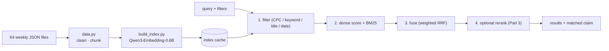

# Patent claim search: hybrid semantic search over vehicle-wheel patent applications

Thinkstruct coding challenge. Built on the small dataset (640 US applications, 2024–2025, CPC B60B wheels / B60C tyres).

**Links:**
- 2-minute walkthrough video (Parts 2 and 3): `<VIDEO LINK>`
- **Patent Explorer UI:** run `uvicorn app.main:app` and open http://127.0.0.1:8000 (Part 3b). The original single-file page is at `/simple`.
- [ARCHITECTURE.md](ARCHITECTURE.md): system map, diagrams, every measurement
- [DESIGN.md](DESIGN.md): Part 2, the system at 10M patents
- [deploy/README.md](deploy/README.md): Part 2 proof of concept on a server

---

## Problem statement

> *Given either a plain-English description of an invention or a specific patent claim, find the patent applications that cover the same thing, and show **which claim** matches. Support examiner-style constraints: CPC classification, keywords in the title or abstract, exact title, and filing date.*

This is the claim-mapping problem from the brief, framed the way an examiner or inventor works. They start from an idea or a claim, narrow by technology area, and need to see *why* a result matched, not just that it did.

**Inputs:**
- free text (`"tire with a sensor that monitors air pressure"`)
- a patent (`--like 20240051333`)
- a single claim (`--like-claim 20240051333:1`)
- any combination of filters

**Outputs:** ranked patents with title, number, CPC and filing week, plus scores, **the best-matching claim** and the query terms found in the title or abstract.

---

## What I built



1. **Indexing** (`data.py`, `build_index.py`). Each patent becomes:
   - one **patent vector** (title + abstract + claims) used for ranking
   - one **vector per claim**, used to show which claim matched
   - The model is **Qwen3-Embedding-0.6B**, chosen from a 2026 benchmark of 22 models on patent prior-art retrieval ([arXiv 2605.24297](https://arxiv.org/html/2605.24297)). It ties the patent-specific `patembed-base` and has an Apache-2.0 licence. MiniLM-L6 is kept as a fast baseline.
2. **Search** (`search.py`). Filters run first, then dense (cosine) and BM25 scoring, then weighted Reciprocal Rank Fusion, then the explain step (best claim per result). Available as a CLI and as an importable `SearchEngine`.
3. **Two-phase search** (`rerank.py`, Part 3a). Stage 1 finds 100 candidates, then a cross-encoder reranks and keeps the top 30.
4. **Evaluation** (`eval_*.py`, `smoke_test.py`), with silver relevance labels, because none come with the data (see §Part 3).
5. **Patent Explorer** (`web/` → `app/static/`, Part 3b). A React + TypeScript interface with three linked views: results with why-it-matched, a CPC drill-down, and a filings timeline. It has removable filter chips, never shows stale results, and saves views.
6. **API + deployment** (`app/`, `deploy/`). FastAPI (`/api/explore`, `/api/search`, …), Docker, and nginx with login and rate limits (Part 2 proof of concept).

### Headline numbers (all measured; reproduce with the commands below)

| | result |
|---|---|
| Known-item search: 12 patents described in my own words | **12/12 in the top 10**; dense alone gets 10/12 at #1 |
| Self-retrieval, all 640 patents (abstract as the query) | **617/640 at #1**, 640/640 in the top 10 |
| Claim → same-CPC-group patents (100 claim queries, nDCG@10, server bundle) | dense 0.539, **hybrid 0.548**, BM25 0.418, random about 0.07 |
| Search time after the query is embedded | **1–3 ms** (640 patents) |
| Query embedding on CPU (Qwen3) | about 100–160 ms |
| Index build | Qwen3 on an RTX 5080 laptop GPU: **185 s**; MiniLM on CPU: 84 s |
| Server bundle (512-d float16) | **10.7 MB** tar.gz, with no measurable quality loss vs 1024-d float32 |
| UI update after a filter change | **36 ms** p50 through the server (5 ms of it on the server), **7 ms** from the client cache |
| UI views disagreeing during fast filter changes against a slow, out-of-order server | **0 of 166** samples |

---

## Data handling decisions

| issue | what I did |
|---|---|
| **Missing fields** | **Keep** a patent if it has a title, an abstract or claims; record what's missing in `Patent.missing`. Skip it only if all three are empty. The small set has none of those, but **119 patents (19%) have an empty description** (`[""]`). They're kept, since descriptions aren't embedded. |
| Canceled claims | 167 claims across 25 patents are placeholders (`(canceled)`, `1 - 15. (canceled)`). They're kept in the claim list so numbering holds, but never embedded or shown as a match. |
| Dependent claims | About 67% of claims depend on another ("The spoke of claim 1, wherein…"). Each claim chunk is prefixed with the patent title for context, and `parent_claim` is recorded. |
| Truncated claim 1 | The data strips claim 1's preamble ("an axle body, …"). This is left as is and noted as the cause of 3 self-retrieval misses. |
| CPC format | The data drops the space and slash, so the split is inferred. Subgroups have at least two digits and B60 main groups at most two: `B60B104FI` → `B60B 1/04`, `B60B2700FI` → `27/00`, `B60C15024FI` → `15/024` (a tyre-bead code). The first version split 5-digit codes as `150/24`; the UI's CPC view exposed that. Filters accept `B60B` (raw prefix) or `B60C 23/` (hierarchical, which does not also match `B60C 2…`). The full dataset has 3-digit main groups in other classes, so it would need a CPC lookup table. |
| Duplicates / corrupt files | Dedupe by `doc_number` (keep the first). Unreadable files are logged and skipped. The small set has neither. |

---

## Part 1: search engine and hybrid search

**Hybrid constraints:**
- CPC prefix: `--cpc B60B`, repeatable (OR)
- keywords in the title or abstract: `--kw sensor --kw-field title|abstract|any` (AND)
- exact title: `--title "LOW NOISE TIRE"`
- filing-week range: `--from / --to`

**Timing with and without hybrid filters** ([results/bench_qwen3.md](results/bench_qwen3.md)):

| scenario | candidates | filter first ("pre") | filter after scoring ("post") |
|---|---|---|---|
| no filters | 640 | 2.8 ms | – |
| `cpc=B60C 23/` | 28 | **0.86 ms** | 3.16 ms |
| `kw=sensor` | 29 | **1.11 ms** | 2.43 ms |
| `cpc=B60C` (half the corpus) | 318 | 2.21 ms | 3.03 ms |
| exact title, no query | 33 | **0.03 ms** (no model call) | – |

Times exclude the query embedding (about 130 ms on CPU), which is the same for every scenario.

**Commentary:**
- **Embedding the query is about 98% of the cost.** At 640 patents, filtering can save at most about 2 ms. The model is what's expensive.
- **Filtering first means filters make search faster, not slower.** Selective filters cut scoring work in proportion to how many patents they exclude.
- **The filters themselves are close to free:**
  - **CPC:** codes are sorted once, and a prefix is a binary search. That took it from 5 ms (string scan) to **0.04 ms**.
  - **Keywords:** an inverted index (word → patents), never a text scan.
  - **Exact title:** a dictionary lookup.
- **At scale, the layout matters more than filtering first.** In a synthetic test at 256K patents with a 10% filter, *copying* the passing rows out of the big matrix took 30 ms, slower than scoring everything (16 ms). Storing vectors **grouped by CPC** turns the filter into a contiguous slice: **2.1 ms**. That's why DESIGN.md partitions the index by CPC.
- **Tuning the fusion weight.** End-to-end testing showed that equal-weight fusion let BM25 push dense #1 hits down to #15–#23 on paraphrased queries. A sweep ([results/hybrid_weight_sweep.md](results/hybrid_weight_sweep.md)) set the BM25 weight to **0.1**:
  - nDCG@10 on claim queries goes from 0.520 to 0.548
  - MRR on paraphrases goes from 0.56 to 0.78
  - `--mode dense` remains available for purely semantic search.

---

## Part 2: implementation at scale

**[DESIGN.md](DESIGN.md)** is written for an intern to start from. It covers:
- **Components:** object storage, **one Postgres + pgvector**, GPU batch workers, a stateless API.
- **Pipelines:** idempotent ingest with a quarantine table; a `SKIP LOCKED` embedding job queue that survives losing spot instances; blue/green model swaps behind an evaluation gate.
- **Query planning:** an exact scan when filters leave fewer than about 50K patents, otherwise HNSW with iterative scan.
- **Sizing and cost:**
  - about $450–850/month self-managed, plus about $50–200 one-off for embedding
  - The embedding estimate is extrapolated from the 5080's measured 3.5 patents/s.
- **Monitoring tables, dashboard and alerts.**
- **Eight expected challenges.** One example: **37% of the large sample has no CPC code**, so a CPC filter silently drops those patents.

**Measured evidence behind the design:**
- **Vector compression** ([results/compression_qwen3.md](results/compression_qwen3.md)). Qwen3 is Matryoshka-trained, so the first 512 dimensions in int8 give **nDCG@10 0.538 vs 0.540** at full size, 8× smaller (about 5 GB for 10M patents).
- **Ranking on one vector per patent, with claim vectors only for explanation,** keeps the index at 10M vectors instead of about 200M.

**Proof of concept** ([deploy/](deploy/)):
- `export_index.py` makes a 10.7 MB server bundle.
- `app/` is a FastAPI API with a search page.
- A CPU-only Docker image, plus docker-compose with an **nginx** front end: basic-auth login, optional IP allowlist, 2 requests/s per IP, `noindex`.
- It's aimed at a 4 vCPU / 16 GB staging server.
- **Verified locally with uvicorn and `smoke_test.py`. The Docker image itself hasn't been built yet** (no Docker on the dev laptop); `deploy/README.md` is the runbook.

---

## Part 3: enhancements

I did two: **3a two-phase search** (reranking) and **3b interface at scale**. The brief recommends 3b for frontend applicants, which matches the role I'm applying for.

### 3a: two-phase search

**Why this one:**
- It fits the small dataset; large data and translation needed other data samples.
- It answers a real question for claim mapping: does a cross-encoder that reads the query and the candidate *together* beat the bi-encoder's separate embeddings?
- It's deployable on a CPU server.
- Evaluating it honestly also meant building an **evaluation pipeline**, which overlaps with the Evaluation & Training option.

**Design:**
- Stage 1 (hybrid) finds 100 candidates; `cross-encoder/ms-marco-MiniLM-L6-v2` reranks them and keeps 30.
- The reranker reads `TITLE. abstract  Claim N: <best claim>`, so it sees the most relevant claim, not claim 1.
- `BAAI/bge-reranker-v2-m3` is supported but took 67 s per query on CPU, so it needs a GPU.

**Evaluation (silver labels):**
- **Query:** a sampled patent's first claim.
- **Relevant:** any other patent in the same CPC main group (e.g. `B60C 23/`, tyre-pressure devices).
- **Sample:** 100 queries.
- **Metrics:** P@10, nDCG@10, MRR@30, R@30.
- **Caveat:** this is a coarse proxy, so compare systems against each other, not as absolute scores.

**Results** (stage 1 = the original equal-weight hybrid; [results/…_n100_w1.md](results/rerank_eval_qwen3_minilm_k100_len512_n100_w1.md), [results/…_fix_w1.md](results/rerank_eval_qwen3_minilm_k100_len512_n100_fix_w1.md)):

| system | nDCG@10 | per query vs stage 1 (better / worse / same) | rerank time (CPU) |
|---|---|---|---|
| stage 1: hybrid | 0.528 | – | – |
| + MiniLM, rerank replaces the ranking (textbook two-phase) | **0.460** | 30 / 59 / 11 | 3.2 s |
| + MiniLM, **merged with stage 1 by RRF** | 0.513 | 44 / 44 / 12 | 3.2 s |
| + MiniLM, merged by RRF, query capped at 64 tokens (default) | 0.517 | 47 / 40 / 13 | 2.6 s |

**Re-run with the current stage 1** (BM25 weight 0.1; [results/…_n100_w0.1.md](results/rerank_eval_qwen3_minilm_k100_len512_n100_w0.1.md)):

| system | nDCG@10 | R@30 | per query vs stage 1 (better / worse / same) | rerank time (CPU) |
|---|---|---|---|---|
| stage 1: hybrid (w = 0.1) | **0.548** | 0.323 | – | – |
| + MiniLM, replace | 0.474 | 0.287 | 28 / 63 / 9 | 3.0 s |
| + MiniLM, merged by RRF | 0.531 | **0.337** | 35 / 47 / 18 | 3.0 s |
| + MiniLM, merged by RRF, query capped at 64 tokens (default) | 0.525 | 0.331 | 38 / 45 / 17 | 2.4 s |

A better stage 1 leaves the reranker even less room to help. Merging by RRF slightly *raises* recall in the top 30 but lowers precision in the top 10. The query cap's earlier +0.004 didn't reproduce, so it's noise; the cap is kept only because it's about 20% faster.

**Findings:**
1. **The off-the-shelf reranker made rankings worse.** It was trained on web question-answering (MS MARCO), not patent claims, and its scores *replaced* a good stage 1.
2. **Merging ranks (RRF) instead of replacing them recovers most of the loss.** A reranker outside its domain can then reorder results but not overturn them. Capping long claim queries helps a little and cuts latency by 20%.
3. **It still doesn't beat stage 1 on these labels:** 0.517 vs 0.528 with the old stage 1, and 0.531 vs 0.548 with the current one. The per-query splits are close to even. On plain-English queries the merged reranker looks better by eye: it moved pressure-monitoring patents to the top for an air-pressure query. Side-by-side tables are in the results files.
4. **Decision:** reranking is **opt-in** in the app (`ENABLE_RERANK=1`, `?rerank=true`), because it costs about 2.6 s per query on CPU for no measured gain.
5. **The next step that would actually help** is a domain-tuned reranker: fine-tune on silver pairs, or on LLM/human verdicts collected by the planned "verify" feature (ARCHITECTURE.md §4). That pipeline is designed but not built.

### 3b: interface at scale (Patent Explorer)

**Stack:** React 19 + TypeScript + Vite in `web/`, with no UI or chart libraries; the timeline and bars are hand-written SVG and CSS. The build is committed to `app/static/`, so FastAPI and the Docker image serve it **without Node**. The visual language (dark monochrome shell, Inter + JetBrains Mono, one green status accent) is adapted from my own site's design system.

**The key design decision: one result set that all views describe.** If each view queried on its own, or if "results" meant "top N *after* filtering", a CPC bar showing 80 could produce 200 results when clicked. So `/api/explore`:
- takes the query's **match set** (its top 200 over the whole corpus, or every patent when there's no query);
- applies the filters as a **subset** of it;
- returns the results page, the CPC counts and the week counts for that same subset in **one response**.

Clicking a bar of 80 always yields 80, and every view's counts sum to the same total. `test_explore.py` checks this.

| brief requirement | how it's met |
|---|---|
| at least 3 linked views | **Results** (meaning score, matched keywords, best-matching claim, query terms highlighted). **CPC breakdown** with drill-down: All › B › B60 › B60C › B60C 23/, with names, and levels that have a single child skipped. **Timeline** of filings by week: click a bar, or drag a range. Clicking a result's CPC or week tag filters too. |
| selecting in one view filters all, counts update | every interaction changes one filter state, which issues one `/api/explore` call, which returns one payload all three views render from |
| filters visible and removable in any order | chips for CPC, date range, each keyword, and "similar to"; plus "Clear filters" |
| a new query keeps the filters | the query action only replaces the query |
| views never disagree; stale results never shown | each request gets an id the server echoes back; a new state cancels the in-flight request; a response renders only if its id is the latest; views draw their selection from the state *that produced the data*, not the live request |
| update latency measured | from the state change to the DOM commit, shown live in the sidebar and kept in `window.__uiPerf` |
| bonus: saved states | named **saved views** (localStorage), **URL hash** state (shareable, works with back/forward), and the last state restored on reload; plus an in-memory response cache (80 entries) |

**Results** ([results/ui_latency.md](results/ui_latency.md)):

| | p50 | p95 |
|---|---|---|
| filter change that needs the server | **36 ms** (round trip 31 ms, server 5 ms) | 56 ms |
| filter change answered from the client cache | **7 ms** | 14 ms |

**Stale-result test:**
- **Setup:** with `ALLOW_DEBUG_DELAY=1`, the sidebar's *Simulate slow, out-of-order server* toggle delays every request randomly by 0–1.5 s. Each round made 7 filter changes in about 150 ms while sampling the views every 20 ms.
- **Result:** **0 of 166** samples had the views disagreeing, and the final screen matched the last action in all 3 rounds.
- **The bug it found first:** the CPC view mixed the new selection with the old counts, and 21 of 33 samples disagreed. It's fixed.

**At 10^7 patents:**
- **Facets** would come from the database (`GROUP BY` on indexed `cpc_group` / `week` columns over the filtered match set) instead of Python loops.
- **The match set** would be an approximate-index top-N.
- **Browse mode** (no query) would read precomputed CPC × week rollups.
- **What stays the same:** the client contract (one payload, request-id guard, response cache). Server time would rise from about 5 ms to tens of ms, covered by keeping the previous view visible but dimmed while updating.

---

## How to run

**Requirements:**
- Python **3.12**. PyTorch and FAISS-style wheels lag the newest Python, so avoid 3.15.
- About 3 GB of disk for models.
- A GPU is optional. It's only useful for building the Qwen3 index: about 3 minutes on GPU vs about 2 hours on CPU.

### 1. Setup

```bash
py -3.12 -m venv .venv
```

```bash
.\.venv\Scripts\Activate.ps1
```

On macOS/Linux, activate with `source .venv/bin/activate` instead.

```bash
pip install -r requirements.txt
```

On Windows this installs CPU-only PyTorch. On Linux, PyPI's default torch includes CUDA libraries (several GB); to avoid that, first run `pip install torch --index-url https://download.pytorch.org/whl/cpu`.

For GPU indexing, replace torch with a CUDA build (the RTX 5080 needs CUDA 12.8 or newer):

```bash
pip install --force-reinstall --no-deps "torch==2.14.1+cu130" --index-url https://download.pytorch.org/whl/cu130
```

### 2. Data

Unzip the small dataset so the JSON files sit in `UTF-8patent_data_small/data/patent_data_small/`, or pass `--data <folder>` to `build_index.py`. Data and caches are gitignored. Then run a sanity check, which prints the load report and chunk counts:

```bash
python data.py
```

### 3. Build an index (Part 1)

```bash
python build_index.py --model qwen3 --device cuda
```

```bash
python build_index.py --model minilm
```

Use `--device cpu` for Qwen3 without a GPU (about 2 h).

### 4. Search (Part 1)

```bash
python search.py "tire with a sensor that monitors air pressure"
```

```bash
python search.py "spoke connecting hub to rim" --cpc B60B --kw spoke -k 5
```

```bash
python search.py --title "PNEUMATIC TIRE"
```

```bash
python search.py --like-claim 20240051333:1 --cpc "B60B 1/"
```

```bash
python search.py -i
```

`-i` is interactive and keeps the model loaded between queries.

### 5. Two-phase search (Part 3)

```bash
python rerank.py "tire with a sensor that monitors air pressure"
```

```bash
python search.py "spoke connecting hub to rim" --rerank minilm
```

### 6. Web app and end-to-end test

```bash
python export_index.py
```

```bash
uvicorn app.main:app --port 8000
```

Open http://127.0.0.1:8000 for Patent Explorer, or `/simple` for the minimal page. The app reads `INDEX_DIR`, which defaults to `deploy/index/qwen3`. In a second terminal:

```bash
python smoke_test.py
```

```bash
python test_explore.py
```

`test_explore.py` checks the facet-consistency invariants. To get the *simulate slow server* toggle in the UI, start the server with `ALLOW_DEBUG_DELAY=1` in its environment.

### 7. Rebuild or develop the UI (optional; Node 20+)

The built UI is already committed in `app/static/`, so this is only needed to change it.

```bash
cd web
```

```bash
npm install
```

```bash
npm run build
```

`npm run build` runs a typecheck and writes the build into `../app/static/`. For hot reload, run `npm run dev` from `web/` while uvicorn is running; Vite serves on :5173 and proxies `/api` to :8000.

### Reproducing the results files

Run `export_index.py` before the two scripts that read `deploy/index/qwen3`.

| file | command | about how long (laptop) |
|---|---|---|
| `results/bench_qwen3.md`, `bench_minilm.md` | `python bench.py` / `python bench.py --index cache/minilm --scale` | 1 min each |
| `results/rerank_eval_…_n100_w1.md` | `python eval_rerank.py --bm25-weight 1.0 --qcaps 0 --fuses replace --out results/rerank_eval_qwen3_minilm_k100_len512_n100_w1.md` | 8 min (CPU) |
| `results/rerank_eval_…_fix_w1.md` | `python eval_rerank.py --bm25-weight 1.0 --qcaps 0 128 64 --out results/rerank_eval_qwen3_minilm_k100_len512_n100_fix_w1.md` | 25 min (CPU) |
| `results/rerank_eval_…_k50_len256_n100_w1.md` | `python eval_rerank.py --bm25-weight 1.0 --qcaps 0 --fuses replace --k1 50 --rr-max-length 256 --threads 4` | 8 min |
| `results/rerank_eval_…_n100_w0.1.md` | `python eval_rerank.py --qcaps 0 64` (current defaults) | 15 min (CPU) |
| `results/hybrid_weight_sweep.md` | `python eval_hybrid_weight.py` (needs `export_index.py` first) | 3 min |
| `results/compression_qwen3.md` | `python eval_compression.py` | 1 min |
| `results/smoke_127_0_0_1.md` | start the app (step 6), then `python smoke_test.py` | 5–10 min |
| `results/ui_latency.md` | start the app with `ALLOW_DEBUG_DELAY=1`, open the UI, change filters; the sidebar shows p50/p95 and `window.__uiPerf` holds the samples (the method is in the file) | 5 min |

**Two notes on reproducing:**
- **The saved Qwen3 cache** was built before canceled claims were dropped at chunking time (11,218 chunks; a fresh build gives 11,051). Search filters canceled claims at load either way, so a rebuild may shift metrics in the third decimal place.
- **Latency numbers depend on the machine:** these came from an AMD Ryzen laptop (12 threads, native bf16) and an RTX 5080 laptop GPU.

---

## Repository layout

| path | purpose |
|---|---|
| `data.py` | load / clean / chunk; CPC parser; canceled-claim filter; BM25 tokenizer |
| `build_index.py` | embedding model registry, index build, `load_index()` |
| `search.py` | `SearchEngine` (filters, dense, BM25, fusion, explain) and the CLI |
| `rerank.py` | Part 3 cross-encoder reranker and `two_phase()` |
| `bench.py` | hybrid-filter timings and the synthetic scale test |
| `eval_rerank.py`, `eval_hybrid_weight.py`, `eval_compression.py` | retrieval-quality evaluations (silver labels) |
| `smoke_test.py` | end-to-end checks against a running API (local or deployed) |
| `export_index.py` | slim server bundle (Matryoshka 512-d, float16) |
| `app/` | FastAPI API; `app/static/` holds the built Patent Explorer and `simple.html` |
| `web/` | Patent Explorer source: React + TypeScript (`src/useExplore.ts` is the stale-result guard) |
| `test_explore.py` | the invariants behind "views never disagree" |
| `deploy/` | Dockerfile, docker-compose, nginx config, runbook |
| `results/` | every number quoted here |
| `ARCHITECTURE.md`, `DESIGN.md` | system map and measurements; the 10M-patent design |

## Limitations and next steps
- **Silver labels only.** Real relevance labels (examiner citations, or a small hand-labelled set) would make the evaluation meaningful in absolute terms.
- **Descriptions aren't searched.** They're about 10K words per patent; a match that only appears in the description is missed.
- **Near-duplicate sibling applications** can crowd the top results. Collapsing results by patent family is a next step.
- **Not yet built:**
  - a domain-tuned reranker
  - the LLM "verify" step with its feedback store (ARCHITECTURE.md §4)
  - the presentation page
  - the Docker deployment hasn't been run on the server yet
- **The UI hasn't been tested on the large dataset.** The 10^7 paragraph above is a design, not a measurement.

*Built with Claude Code as an AI pair-programmer, as the brief allows.*
